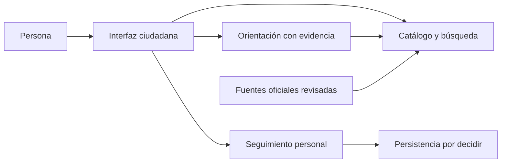

# Arquitectura conceptual propuesta

Estado: diseño de producto propuesto. Base de herramientas Python/uv configurada; frameworks, IA y persistencia pendientes. El ámbito inicial es Hermosillo. Estos límites pueden implementarse en una sola aplicación modular. Crear servicios separados sólo si una decisión aceptada lo justifica.

## Responsabilidades

- Interfaz: búsqueda, detalle del trámite, conversación, fuentes, checklist y presentación accesible de errores y estado.
- Catálogo/API: validar datos, filtrar jurisdicción, entregar evidencia y distinguir desconocido de cero o gratuito.
- Asistente: recuperar evidencia del catálogo, explicar con lenguaje claro y abstenerse si no alcanza. No modifica requisitos ni estados.
- Seguimiento: almacenar avances declarados por el usuario y su procedencia. La identidad y persistencia siguen pendientes.
- Contratos: definir entradas, salidas, errores y versiones sin depender del proveedor de modelo.
- Ingesta: registrar fuente, capturar contenido permitido, revisar, versionar y publicar. El contenido sin revisar no llega al catálogo público.

## Límites e interfaces

No hay endpoints implementados. Antes de programar, acordar contratos para búsqueda (consulta y jurisdicción), detalle por identificador estable, orientación (pregunta y referencias) y seguimiento (evento y origen). Incluir ejemplos sintéticos, campos obligatorios, errores y reglas de compatibilidad en `packages/contracts/`.

Toda mutación debe validarse del lado que conserva los datos. Si hay múltiples usuarios, comprobar autorización por recurso. Separar entornos demo y producción; no usar un booleano visual como control de acceso.

## Fallos previstos

Sin IA: conservar consulta directa al catálogo. Sin fuentes suficientes: explicar el límite y ofrecer canal oficial verificado si está disponible. Sin integración gubernamental: mostrar sólo seguimiento personal. Sin persistencia: advertir antes de registrar avances que no se conservarán. Sin red: usar fixtures claramente rotulados para la demo, sin afirmar actualidad oficial.

No afirmar disponibilidad 24/7 a partir de un prototipo local: es un resultado esperado del reto que requerirá despliegue y operación medibles.

## Continuidad del repositorio

Antes de iniciar una sesión, consulta [TODO.md](../TODO.md) para pendientes y [CHANGELOG.md](../CHANGELOG.md) para cambios recientes. Actualízalos al cerrar trabajo relevante; no marques tareas pendientes como realizadas.
